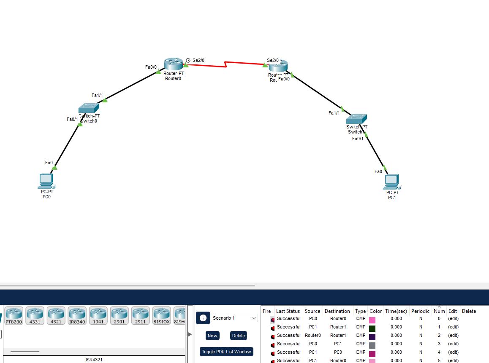
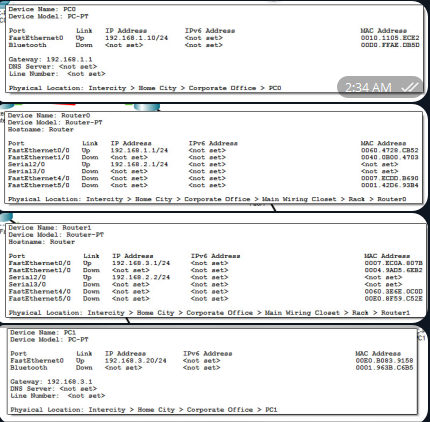

# Cisco Packet Tracer Labs

Cisco Packet Tracer labs for the Computer Networks course at AIUB.

## Labs

| Lab | Topic | File |
|-----|-------|------|
| [Lab 01](lab-01/) | Two-router topology with serial link | [two-router-serial-topology.pkt](lab-01/two-router-serial-topology.pkt) |
| [Lab 03](lab-03/) | EIGRP routing with three routers | [eigrp-three-router-topology.pkt](lab-03/eigrp-three-router-topology.pkt) |

---

## Lab 01: Two-Router Serial Topology

### Overview
Two LANs connected through two routers over a serial link. Each LAN has one switch and one PC. After configuration, all devices can reach each other using ICMP ping.

### Topology


```
PC0 -- Switch0 -- Router0 ==(Serial)== Router1 -- Switch1 -- PC1
```

### IP Addressing

| Device  | Interface | IP Address   | Subnet Mask   | Default Gateway |
|---------|-----------|--------------|---------------|-----------------|
| PC0     | Fa0       | 192.168.1.10 | 255.255.255.0 | 192.168.1.1     |
| Router0 | Fa0/0     | 192.168.1.1  | 255.255.255.0 | N/A             |
| Router0 | Se2/0     | 192.168.2.1  | 255.255.255.0 | N/A             |
| Router1 | Se2/0     | 192.168.2.2  | 255.255.255.0 | N/A             |
| Router1 | Fa0/0     | 192.168.3.1  | 255.255.255.0 | N/A             |
| PC1     | Fa0       | 192.168.3.20 | 255.255.255.0 | 192.168.3.1     |



### Routing
Static routes on both routers.

**Router0**
```
ip route 192.168.3.0 255.255.255.0 192.168.2.2
```

**Router1**
```
ip route 192.168.1.0 255.255.255.0 192.168.2.1
```

### Testing
ICMP ping tested between PC0, PC1, Router0 and Router1. All results: **Successful**.

### How to Open
Open `lab-01/two-router-serial-topology.pkt` in Cisco Packet Tracer.

---

## Lab 03: EIGRP with Three Routers

### Overview
Three LANs connected through three routers. EIGRP (AS 1) is used so every router learns every network dynamically. Goal: PCs and laptops in different LANs can ping each other.

### Topology


```
PC0, PC1 -- Switch0 -- Router0 -- Router1 -- Router2 -- Switch2 -- PC2
                                     |
                                  Switch1 -- Laptop0, Laptop1
```

### Router Interfaces

| Router  | Port  | Connected To     | IP Address  | Subnet Mask     |
|---------|-------|------------------|-------------|-----------------|
| Router0 | Fa0/0 | Switch0 (LAN)    | 200.20.20.1 | 255.255.255.248 |
| Router0 | Fa0/1 | Router1          | 10.0.0.1    | 255.0.0.0       |
| Router1 | Fa0/1 | Router0          | 10.0.0.2    | 255.0.0.0       |
| Router1 | Fa0/0 | Switch1 (LAN)    | 172.16.0.1  | 255.255.0.0     |
| Router1 | Eth1/0| Router2          | 195.10.10.1 | 255.255.255.252 |
| Router2 | Fa0/1 | Router1          | 195.10.10.2 | 255.255.255.252 |
| Router2 | Fa0/0 | Switch2 (LAN)    | 213.10.10.1 | 255.255.255.252 |

All used interfaces are enabled with `no shutdown`.

### End Devices

| Device  | IP Address  | Subnet Mask     | Default Gateway |
|---------|-------------|-----------------|-----------------|
| PC0     | 200.20.20.2 | 255.255.255.248 | 200.20.20.1     |
| PC1     | 200.20.20.3 | 255.255.255.248 | 200.20.20.1     |
| Laptop0 | 172.16.0.2  | 255.255.0.0     | 172.16.0.1      |
| Laptop1 | 172.16.0.3  | 255.255.0.0     | 172.16.0.1      |
| PC2     | 213.10.10.2 | 255.255.255.252 | 213.10.10.1     |

### EIGRP Configuration

**Router0**
```
router eigrp 1
 network 10.0.0.0 0.255.255.255
 network 200.20.20.0 0.0.0.7
 no auto-summary
```

**Router1**
```
router eigrp 1
 network 10.0.0.0 0.255.255.255
 network 172.16.0.0 0.0.255.255
 network 195.10.10.0 0.0.0.3
 no auto-summary
```

**Router2**
```
router eigrp 1
 network 195.10.10.0 0.0.0.3
 network 213.10.10.0 0.0.0.3
 no auto-summary
```

### Verification
- `show ip interface brief`: all used interfaces should be up/up
- `show ip route`: Router0 should show EIGRP (`D`) routes for 172.16.0.0 and 213.10.10.0
- Ping order: PC to its gateway, then the next router, then the remote device


### How to Open
Open `lab-03/eigrp-three-router-topology.pkt` in Cisco Packet Tracer.

---

## Tools
- Cisco Packet Tracer

## Author
Tajmun, AIUB
