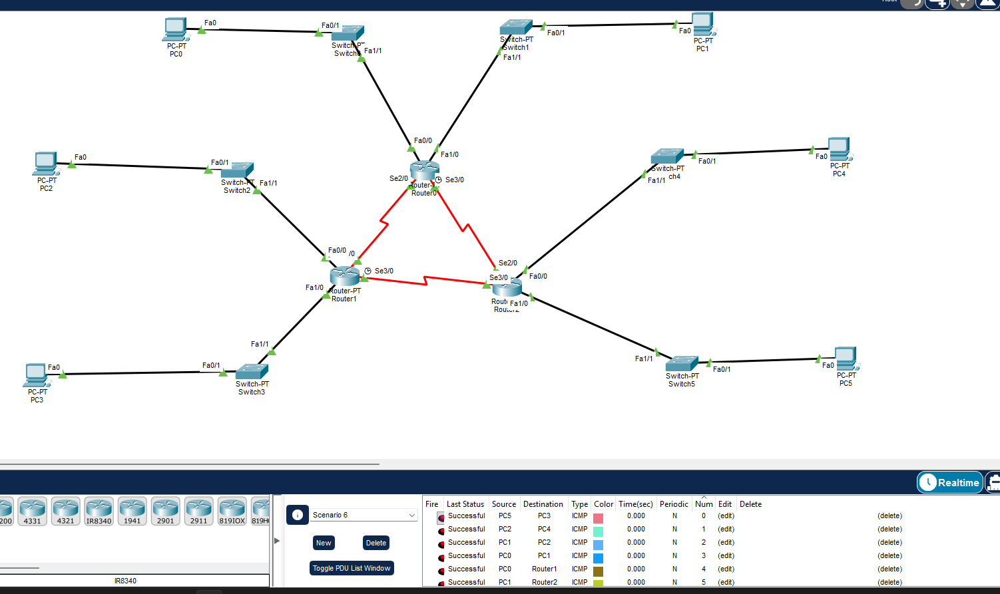
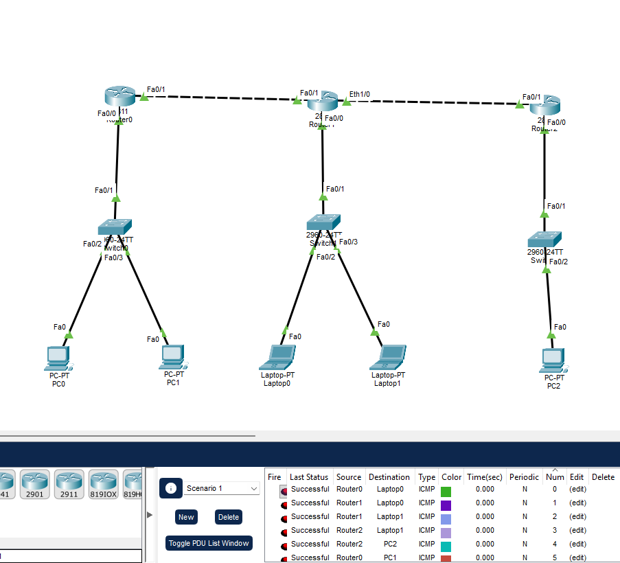
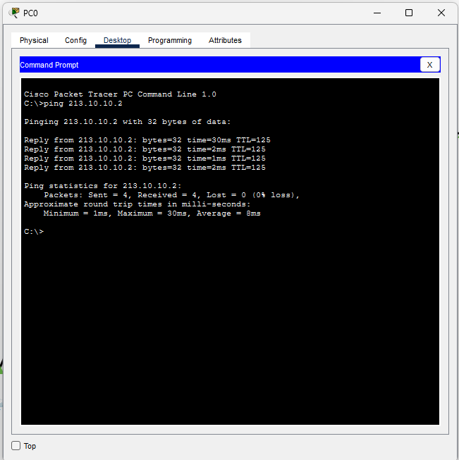

# Cisco Packet Tracer Labs

Cisco Packet Tracer labs for the Computer Networks course at AIUB.

## Labs

| Lab | Topic | File |
|-----|-------|------|
| [Lab 01](lab-01/) | Two-router topology with serial link | [two-router-serial-topology.pkt](lab-01/two-router-serial-topology.pkt) |
| [Lab 02](lab-02/) | VLSM subnetting with three routers (RIPv2) | [vlsm-three-router-topology.pkt](lab-02/vlsm-three-router-topology.pkt) |
| [Lab 03](lab-03/) | EIGRP routing with three routers | [eigrp-three-router-topology.pkt](lab-03/eigrp-three-router-topology.pkt) |

---

## Lab 01: Two-Router Serial Topology

### Overview
Two LANs connected through two routers over a serial link. Each LAN has one switch and one PC. After configuration, all devices can reach each other using ICMP ping.

### Topology


```
PC0 -- Switch0 -- Router0 ==(Serial)== Router1 -- Switch1 -- PC1
```

### IP Addressing

| Device  | Interface | IP Address   | Subnet Mask   | Default Gateway |
|---------|-----------|--------------|---------------|-----------------|
| PC0     | Fa0       | 192.168.1.10 | 255.255.255.0 | 192.168.1.1     |
| Router0 | Fa0/0     | 192.168.1.1  | 255.255.255.0 | N/A             |
| Router0 | Se2/0     | 192.168.2.1  | 255.255.255.0 | N/A             |
| Router1 | Se2/0     | 192.168.2.2  | 255.255.255.0 | N/A             |
| Router1 | Fa0/0     | 192.168.3.1  | 255.255.255.0 | N/A             |
| PC1     | Fa0       | 192.168.3.20 | 255.255.255.0 | 192.168.3.1     |


### Routing
Static routes on both routers.

**Router0**
```
ip route 192.168.3.0 255.255.255.0 192.168.2.2
```

**Router1**
```
ip route 192.168.1.0 255.255.255.0 192.168.2.1
```

### Testing
ICMP ping tested between PC0, PC1, Router0 and Router1. All results: **Successful**.

### How to Open
Open `lab-01/two-router-serial-topology.pkt` in Cisco Packet Tracer.

---

## Lab 02: VLSM with Three Routers

### Overview
Three routers (HQ, Br-1, Br-2) connected in a triangle through serial links. Each router has two LANs (one switch and one PC each), so there are six LANs and three point-to-point links. The block `192.168.1.0/24` is divided using VLSM: each LAN gets a subnet sized to its host count and each serial link uses a /30. RIPv2 with `no auto-summary` is used so the routers can carry subnets of different sizes.

### Topology


### VLSM Subnet Plan
Subnets are allocated from the largest host requirement to the smallest.

| Network          | Hosts | Subnet            | Mask            | Usable Range        | Broadcast      |
|------------------|-------|-------------------|-----------------|---------------------|----------------|
| LAN 1 (PC0)      | 50    | 192.168.1.0/26    | 255.255.255.192 | .1 - .62            | 192.168.1.63   |
| LAN 2 (PC1)      | 50    | 192.168.1.64/26   | 255.255.255.192 | .65 - .126          | 192.168.1.127  |
| LAN 3 (PC2)      | 20    | 192.168.1.128/27  | 255.255.255.224 | .129 - .158         | 192.168.1.159  |
| LAN 4 (PC3)      | 20    | 192.168.1.160/27  | 255.255.255.224 | .161 - .190         | 192.168.1.191  |
| LAN 5 (PC4)      | 12    | 192.168.1.192/28  | 255.255.255.240 | .193 - .206         | 192.168.1.207  |
| LAN 6 (PC5)      | 12    | 192.168.1.208/28  | 255.255.255.240 | .209 - .222         | 192.168.1.223  |
| HQ - Br-1 link   | 2     | 192.168.1.224/30  | 255.255.255.252 | .225 - .226         | 192.168.1.227  |
| HQ - Br-2 link   | 2     | 192.168.1.228/30  | 255.255.255.252 | .229 - .230         | 192.168.1.231  |
| Br-1 - Br-2 link | 2     | 192.168.1.232/30  | 255.255.255.252 | .233 - .234         | 192.168.1.235  |

### Router Interfaces
This file uses Router-PT routers (`Fa0/0`, `Fa1/0`, `Se2/0`, `Se3/0`).

| Router          | Port  | Connected To             | IP Address    | Subnet Mask     |
|-----------------|-------|--------------------------|---------------|-----------------|
| Router0 (HQ)    | Fa0/0 | Switch0 (LAN 1)          | 192.168.1.1   | 255.255.255.192 |
| Router0 (HQ)    | Fa1/0 | Switch1 (LAN 2)          | 192.168.1.65  | 255.255.255.192 |
| Router0 (HQ)    | Se2/0 | Router1 Se2/0            | 192.168.1.225 | 255.255.255.252 |
| Router0 (HQ)    | Se3/0 | Router2 Se2/0            | 192.168.1.229 | 255.255.255.252 |
| Router1 (Br-1)  | Fa0/0 | Switch2 (LAN 3)          | 192.168.1.129 | 255.255.255.224 |
| Router1 (Br-1)  | Fa1/0 | Switch3 (LAN 4)          | 192.168.1.161 | 255.255.255.224 |
| Router1 (Br-1)  | Se2/0 | Router0 Se2/0            | 192.168.1.226 | 255.255.255.252 |
| Router1 (Br-1)  | Se3/0 | Router2 Se3/0            | 192.168.1.233 | 255.255.255.252 |
| Router2 (Br-2)  | Fa0/0 | Switch4 (LAN 5)          | 192.168.1.193 | 255.255.255.240 |
| Router2 (Br-2)  | Fa1/0 | Switch5 (LAN 6)          | 192.168.1.209 | 255.255.255.240 |
| Router2 (Br-2)  | Se2/0 | Router0 Se3/0            | 192.168.1.230 | 255.255.255.252 |
| Router2 (Br-2)  | Se3/0 | Router1 Se3/0            | 192.168.1.234 | 255.255.255.252 |

### End Devices

| Device | IP Address    | Subnet Mask     | Default Gateway |
|--------|---------------|-----------------|-----------------|
| PC0    | 192.168.1.2   | 255.255.255.192 | 192.168.1.1     |
| PC1    | 192.168.1.66  | 255.255.255.192 | 192.168.1.65    |
| PC2    | 192.168.1.130 | 255.255.255.224 | 192.168.1.129   |
| PC3    | 192.168.1.162 | 255.255.255.224 | 192.168.1.161   |
| PC4    | 192.168.1.194 | 255.255.255.240 | 192.168.1.193   |
| PC5    | 192.168.1.210 | 255.255.255.240 | 192.168.1.209   |

### Routing (RIPv2)
Same configuration on all three routers:

```
router rip
 version 2
 network 192.168.1.0
 no auto-summary
```

### Verification
- `show ip interface brief`: all used interfaces should be up/up
- `show ip route`: every router should show `R` (RIP) routes for the subnets it is not directly connected to
- Ping tests: PC0 to PC5 (`ping 192.168.1.210`) and PC4 to PC3 (`ping 192.168.1.162`)
```

 
```
### How to Open
Open `lab-02/vlsm-three-router-topology.pkt` in Cisco Packet Tracer.

---

## Lab 03: EIGRP with Three Routers

### Overview
Three LANs connected through three routers. EIGRP (AS 1) is used so every router learns every network dynamically. Goal: PCs and laptops in different LANs can ping each other.

### Topology


```
PC0, PC1 -- Switch0 -- Router0 -- Router1 -- Router2 -- Switch2 -- PC2
                                     |
                                  Switch1 -- Laptop0, Laptop1
```

### Router Interfaces

| Router  | Port   | Connected To  | IP Address  | Subnet Mask     |
|---------|--------|---------------|-------------|-----------------|
| Router0 | Fa0/0  | Switch0 (LAN) | 200.20.20.1 | 255.255.255.248 |
| Router0 | Fa0/1  | Router1       | 10.0.0.1    | 255.0.0.0       |
| Router1 | Fa0/1  | Router0       | 10.0.0.2    | 255.0.0.0       |
| Router1 | Fa0/0  | Switch1 (LAN) | 172.16.0.1  | 255.255.0.0     |
| Router1 | Eth1/0 | Router2       | 195.10.10.1 | 255.255.255.252 |
| Router2 | Fa0/1  | Router1       | 195.10.10.2 | 255.255.255.252 |
| Router2 | Fa0/0  | Switch2 (LAN) | 213.10.10.1 | 255.255.255.252 |

All used interfaces are enabled with `no shutdown`.

### End Devices

| Device  | IP Address  | Subnet Mask     | Default Gateway |
|---------|-------------|-----------------|-----------------|
| PC0     | 200.20.20.2 | 255.255.255.248 | 200.20.20.1     |
| PC1     | 200.20.20.3 | 255.255.255.248 | 200.20.20.1     |
| Laptop0 | 172.16.0.2  | 255.255.0.0     | 172.16.0.1      |
| Laptop1 | 172.16.0.3  | 255.255.0.0     | 172.16.0.1      |
| PC2     | 213.10.10.2 | 255.255.255.252 | 213.10.10.1     |

### EIGRP Configuration

**Router0**
```
router eigrp 1
 network 10.0.0.0 0.255.255.255
 network 200.20.20.0 0.0.0.7
 no auto-summary
```

**Router1**
```
router eigrp 1
 network 10.0.0.0 0.255.255.255
 network 172.16.0.0 0.0.255.255
 network 195.10.10.0 0.0.0.3
 no auto-summary
```

**Router2**
```
router eigrp 1
 network 195.10.10.0 0.0.0.3
 network 213.10.10.0 0.0.0.3
 no auto-summary
```

### Verification
- `show ip interface brief`: all used interfaces should be up/up
- `show ip route`: Router0 should show EIGRP (`D`) routes for 172.16.0.0 and 213.10.10.0
- Ping order: PC to its gateway, then the next router, then the remote device




### How to Open
Open `lab-03/eigrp-three-router-topology.pkt` in Cisco Packet Tracer.

---

## Tools
- Cisco Packet Tracer

## Author
Tajmun, AIUB
